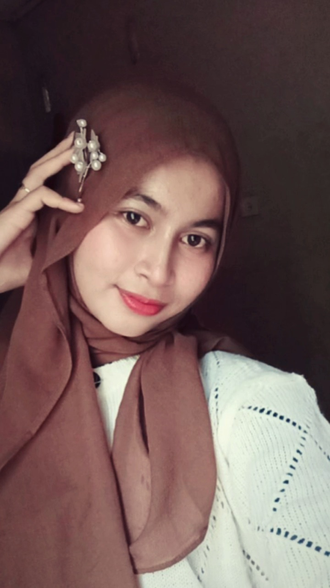

<!DOCTYPE html>
<html lang="id">
<head>
    <meta charset="UTF-8">
    <meta name="viewport" content="width=device-width, initial-scale=1.0">
    <title>Profil Mahasiswa | Risyawatul Fitri</title>
    <link rel="stylesheet" href="tesstyle.css">
</head>
<body>

    <!-- NAVBAR -->
    <header class="navbar">
        <a href="#beranda" class="logo">MyProfile.</a>

        <nav class="nav-menu">
            <a href="#beranda">Beranda</a>
            <a href="#tentang">Tentang</a>
            <a href="#pendidikan">Pendidikan</a>
            <a href="#keahlian">Keahlian</a>
            <a href="#kontak">Kontak</a>
        </nav>
    </header>

    <main>
        <!-- BERANDA -->
        <section class="hero" id="beranda">
            

                
HALO, PERKENALKAN SAYA

                <h1>Risyawatul Fitri</h1>

                <h2>Mahasiswa Teknik Informatika</h2>

                

                    Saya adalah mahasiswa yang tertarik dengan
                    pemrograman web, pengembangan aplikasi,
                    dan teknologi informasi. Saya senang mempelajari
                    hal baru dan mengembangkan kemampuan di bidang teknologi.
                

                

                    <a href="#kontak" class="button">Hubungi Saya</a>
                    <a href="#tentang" class="button button-outline">
                        Tentang Saya
                    </a>
                

                

                    
                    Terus belajar, berkembang, dan berkarya
                

            

            

                
                

                    Mahasiswa
                    <strong>Teknik Informatika</strong>
                

            

        </section>

        <!-- TENTANG SAYA -->
        <section class="content-section" id="tentang">
            

                
KENALI SAYA

                <h2>Tentang Saya</h2>
                

                    Sedikit cerita tentang diri dan minat saya.
                

            

            

                
✦

                

                    <h3>Halo, senang berkenalan dengan kamu!</h3>

                    

                        Halo! Perkenalkan, saya Risyawatul Fitri, mahasiswa Program Studi Teknik Informatika 
                        di Universitas Samudra. Saya adalah pribadi yang memiliki semangat untuk terus belajar, 
                        mengembangkan kemampuan, dan mencoba hal-hal baru. Saya tertarik pada bidang teknologi, 
                        khususnya pengembangan website, serta senang mengembangkan kemampuan komunikasi dan public speaking.
                        
                        Saya juga menyukai kerja sama tim, bertukar ide, dan belajar bersama untuk mencapai tujuan. 
                        Bagi saya, setiap pengalaman merupakan kesempatan untuk menambah pengetahuan, meningkatkan keterampilan, 
                        dan menjadi pribadi yang lebih baik.
                        Melalui website portofolio ini, saya ingin memperkenalkan diri, menampilkan perjalanan pendidikan, 
                        kemampuan, serta proyek yang saya kerjakan sebagai bagian dari proses belajar dan pengembangan diri.
                    

                    

                        Teknologi
                        Pemrograman Web
                        Pengembangan Diri
                    

                

            

        </section>

        <!-- PENDIDIKAN -->
        <section class="content-section section-alt" id="pendidikan">
            

                
RIWAYAT AKADEMIK

                <h2>Pendidikan Saya</h2>
                

                    Perjalanan pendidikan saya.
                

            

            

                

                    
01

                    

                        PENDIDIKAN TINGGI
                        <h3>Universitas Samudra</h3>
                        
Program Studi Teknik Informatika

                        
Mahasiswa S1

                    

                     

                

                    
02

                    

                        SEKOLAH MENENGAH ATAS
                        <h3>SMA N 1 Tanah Jambo Aye</h3>
                        
Program Studi Teknik Informatika

                        
2022-2025

                    

                    

                

                    
03

                    

                        SEKOLAH MENENGAH PERTAMA
                        <h3>SMP N 2 MADAT</h3>
                        
Program Studi Teknik Informatika

                        
2019-2020

                    

                    

                

                    
04

                    

                        SEKOLAH DASAR
                        <h3>SD MATANG GURU</h3>
                        
Program Studi Teknik Informatika

                        
2013-2019

                    

                

                <!-- Tambahkan pendidikan sebelumnya jika diperlukan -->
            

        </section>

        <!-- KEAHLIAN -->
        <section class="content-section" id="keahlian">
            

                
KEMAMPUAN SAYA

                <h2>Keahlian</h2>
                

                    Beberapa bidang yang saya pelajari dan kembangkan.
                

            

            

                <article class="skill-card">
                    
🎤

                    <h3>Publik Speaking</h3>
                    
Menyampaikan ide dan berbicara di depan umum.

                    Soft skill
                </article>

                <article class="skill-card">
                    
🤝

                    <h3>Kerja Sama Tim</h3>
                    
Berkolaborasi dan menyelesaikan tugas bersama tim.

                    Soft skill
                </article>

                <article class="skill-card">
                    
💡

                    <h3>Kemauan Belajar</h3>
                    
Terus belajar dan mengembangkan kemampuan baru.

                    Pengembangan Diri
                </article>
            

        </section>

        <!-- MEDIA SOSIAL -->
        
<!-- Media Sosial -->
<section id="media-sosial" class="content-section">
  
LET'S CONNECT

  <h2 class="section-heading">Media Sosial</h2>
  

    Yuk, terhubung dengan saya melalui media sosial berikut!
  

  

    <a href="https://www.instagram.com/riesyaawftrii_?stkn=MWg5cWNpZTQwNDFyYw=="
       target="_blank" rel="noopener noreferrer"
       class="social-card instagram">
      <i class="fa-brands fa-instagram"></i>
      <h3>Instagram</h3>
      
riesyaawftrii_

      Kunjungi Profil ↗
    </a>

    <a href="https://linkedin.com/in/usernamekamu"
       target="_blank" rel="noopener noreferrer"
       class="social-card linkedin">
      <i class="fa-brands fa-linkedin"></i>
      <h3>LinkedIn</h3>
      
Risyawatul-Fitri

      Kunjungi Profil ↗
    </a>

    <a href="https://github.com/Risyawatul-Fitri"
       target="_blank" rel="noopener noreferrer"
       class="social-card github">
      <i class="fa-brands fa-github"></i>
      <h3>GitHub</h3>
      
Risyawatul-Fitri

      Kunjungi Profil ↗
    </a>

  

</section>

        <!-- KONTAK -->
        <section class="content-section" id="kontak">
            

                
MARI TERHUBUNG

                <h2>Hubungi Saya</h2>

                

                    Terima kasih sudah mengunjungi website profil saya.
                    Kamu bisa menghubungi saya melalui informasi kontak
                    yang nantinya saya lengkapi di bawah ini.
                

                

                    

                        ✉
                        

                            <strong>Email</strong>
                            
Tambahkan alamat email kamu

                        

                    

                    

                        ◎
                        

                            <strong>Instagram</strong>
                            
Tambahkan username Instagram kamu

                        

                    

                

                <a href="#beranda" class="button">Kembali ke Atas ↑</a>
            

        </section>
    </main>

    <!-- FOOTER -->
    <footer class="footer">
        <a href="#beranda" class="logo">MyProfile.</a>

        

            © 2026 Risyawatul Fitri.
            Dibuat sebagai website profil mahasiswa.
        

        <a href="#beranda" class="footer-link">Kembali ke Beranda ↑</a>
    </footer>

</body>
</html>
